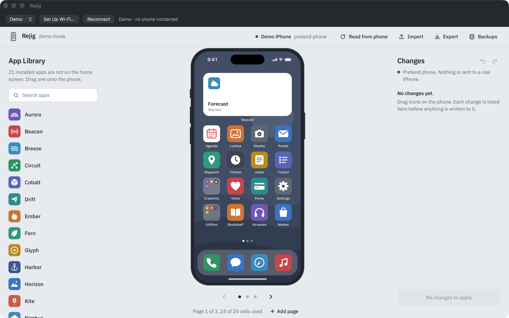
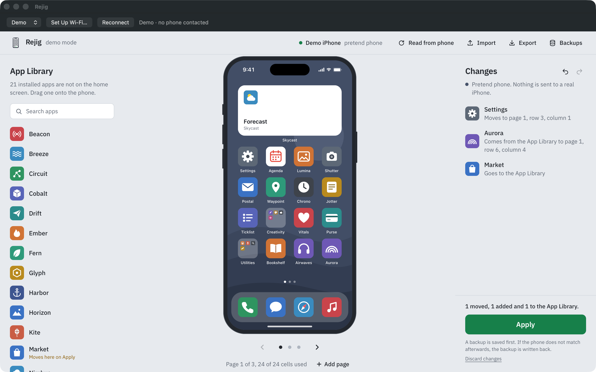

# Rejig

Rejig is a Mac app for arranging the real Home Screen on your iPhone: pages, the dock,
folders, existing widgets, and which apps live only in the App Library. Nothing is
installed on the phone. Rejig lists every change before you apply it, saves a backup
first, and reads the phone back afterwards to check the result.

It works over **Wi-Fi** after a one-time USB pairing, so day to day you don't need a cable.
USB works too, and **Demo** mode lets you try everything on a pretend phone.





*Screenshots use Demo mode: invented apps on a pretend phone, no real device.*

## What it does

- Reads the Home Screen layout from your iPhone over Wi-Fi or USB.
- Lets you drag apps, folders and existing widgets; add and remove pages; create folders;
  move apps to and from the App Library.
- Lists every change (moved, added, sent to the App Library) before you press **Apply**.
- Saves a layout backup before each write, then reads the phone again to confirm it holds
  what was written. If that check fails, it writes the backup back and checks again.
- Restores an earlier backup (**Backups**) after a confirmation that shows its date and
  item counts, then reads the phone back to check it. A restore does not list every item.
- Writes a backup or an edited layout only to the iPhone it came from. A different iPhone,
  or one whose identity is unknown, gets nothing.
- Imports and exports layouts as files.

## Requirements

- A Mac with Apple silicon (M1 or later) running macOS 15 or later.
- Xcode Command Line Tools: `xcode-select --install`
- [Homebrew](https://brew.sh) and Python 3.13: `brew install python@3.13`
- An internet connection during installation (it downloads about 100 Python packages).
- An iPhone on iOS 17 or later for Wi-Fi mode.

## Install

1. Get the source:

   ```bash
   git clone https://github.com/rejig-app/rejig.git
   cd rejig
   ```

2. Build the app (a few seconds):

   ```bash
   bash scripts/build.sh
   ```

3. Install the app and its Python runtime (a few minutes, mostly downloads):

   ```bash
   bash scripts/install.sh
   ```

   This puts the app in `~/Applications/Rejig.app` and its runtime in
   `~/Library/Application Support/Rejig/.venv`. Dependencies are installed at the exact
   versions, with hash checks, listed in `requirements.lock`.

4. Open it:

   ```bash
   open ~/Applications/Rejig.app
   ```

5. Choose **Demo** in the top bar to try it without a phone.

The app is built and signed ad hoc on your own Mac; it is not notarized. It needs both
the app and the runtime folder. If a Homebrew upgrade removes Python 3.13, run
`bash scripts/install.sh` again.

## Connect your iPhone

**USB:** plug the iPhone in, unlock it, tap **Trust This Computer**, choose **USB**, then
**Read from phone**.

**Wi-Fi (one-time setup):**

1. Connect the iPhone to this Mac with USB. Unlock it and accept **Trust This Computer**.
2. Click **Set Up Wi-Fi…**, then **Pair Connected iPhone**. This turns on wireless device
   connections and saves a pairing on the Mac.
3. Unplug the cable. Keep the phone unlocked and on the same network as the Mac.
4. Choose **Wi-Fi**, then **Read from phone**. Allow local network access if macOS asks.

Wi-Fi mode uses the engine's userspace RemotePairing tunnel. It needs neither root nor
Developer Mode. Use one iPhone at a time: the engine refuses to guess when several phones
are connected or paired.

## AI clients (MCP)

An MCP companion for Claude Desktop, Claude Code and Codex is in progress. This version has
no MCP server yet. When it lands, this section will cover adding it to each client,
checking it is connected, and example prompts.

## Your data

- Layouts and backups: `~/Library/Application Support/Rejig/data/`
- Cached app icons and wallpaper: `~/Library/Application Support/Rejig/cache/`
- Connection errors: `~/Library/Application Support/Rejig/backend.log`
- Wi-Fi pairing output: `~/Library/Application Support/Rejig/pairing.log`
- Wi-Fi pairing credentials: pymobiledevice3's folder, `~/.local/share/pymobiledevice3/`
  (or `~/.pymobiledevice3/` if an older install created it). Treat these like passwords
  and don't share them.

Everything stays on your Mac. The editor inside the window listens only on `127.0.0.1`,
with a fresh session token and request checks; it is not reachable from your network.

Don't disconnect or force-quit while Rejig is applying or restoring. If the check and the
rollback both fail, Rejig says so and keeps the backup: reconnect and use **Backups**.
A layout backup is not a full iPhone backup.

## Checks

```bash
build/Rejig.app/Contents/MacOS/Rejig --self-test
build/Rejig.app/Contents/MacOS/Rejig --smoke-test
"$HOME/Library/Application Support/Rejig/.venv/bin/python3" -m unittest discover -s tests -v
```

The smoke test opens the real window on a pretend phone, adds and undoes a page, reorders
icons, opens the Apply preview, applies, checks the backup and readback, and restores the
backup. It never contacts a real phone. It saves `demo-preview.png` in the app's data folder.

The unit tests cover the Wi-Fi pairing proof format, the Wi-Fi reconnect patch
(recovery, same-phone check, USB failure, cancellation) and the device identity patch
(Restore and Apply refuse another iPhone and still write to the right one).

## Tested on

- Macs: Apple silicon on macOS 26.
- iPhone: an iPhone 16 Pro on iOS 27.0.1, over USB and Wi-Fi: layout reads, writes with
  readback, and a backup restore.

That is one phone. Apple can change the private Home Screen service in any iOS release,
so try Demo first and keep the backup Rejig makes. Intel Macs, Windows and Linux are not
supported.

## Limits

- The installer applies two patches to the engine. `patches/wifi-reconnect.patch`: a
  layout write can close the Wi-Fi tunnel, and the patch reopens it for the same phone
  only. `patches/device-identity.patch`: Restore and Apply check that the connected phone
  is the one the backup or layout came from before writing.
- Apps that were offloaded may show up after a write even though the phone did not list
  them before. Read the phone again and check the layout before you rely on it.
- Rejig moves existing widgets and stacks; it cannot create new widgets.
- `srptools` stays at 1.0.1: version 2 reads pymobiledevice3's hex-encoded pairing proof
  as raw bytes and Wi-Fi pairing fails. Proof checking stays on.

## Credits

Rejig is by keyclipse. The Mac window, connection controls, installer and the two engine
patches are Rejig's own work, under the MIT license.

Reading and writing the layout, the editor you see in the window and Demo mode come from
[ios-homescreen](https://github.com/YakupEmreYerli/ios-homescreen) by Yakup Emre Yerli
(MIT), pinned at `97649547dbc4`. ios-homescreen talks to the iPhone through
[pymobiledevice3](https://github.com/doronz88/pymobiledevice3) by doronz88 and
contributors (GPL-3.0-or-later), which runs inside the engine's Python process. Rejig
starts that process and talks to it over a loopback connection. Wi-Fi pairing uses
[srptools](https://github.com/idlesign/srptools) (BSD-3-Clause). See
[THIRD_PARTY_NOTICES.md](THIRD_PARTY_NOTICES.md).

Rejig does not implement Apple's device protocols itself. It is not affiliated with or
endorsed by Apple, ios-homescreen or pymobiledevice3. iPhone is a trademark of Apple Inc.

## License

MIT. See [LICENSE](LICENSE).
